


 

&nbsp;
&nbsp;

  




 

I design and ship AI-powered applications from idea to deployment: LLM workflows, retrieval-augmented generation (RAG), AI agents and the backend that holds them together. CS undergrad at **Iqra University** (CGPA 3.75), based in Karachi, Pakistan.

- 🤖 Building with **AI agents, RAG and LLMs**
- ⚙️ Automating real workflows with **n8n, Flask and REST APIs**
- 🗄️ Working with **vector databases and semantic search**
- 🎓 Finished the **AI Engineering & Automation internship at The Techzeen**, where I built Probe
- 📫 Open to software engineering, AI and backend roles, internships and entry-level


<table>
<tr>
<td width="50%"><a href="https://github.com/Hassan-Shahzad2?tab=repositories"></a></td>
<td width="50%"><a href="https://github.com/Hassan-Shahzad2?tab=repositories"></a></td>
</tr>
<tr>
<td width="50%"><a href="https://github.com/Hassan-Shahzad2?tab=repositories"></a></td>
<td width="50%"><a href="https://github.com/Hassan-Shahzad2?tab=repositories"></a></td>
</tr>
<tr>
<td width="50%"><a href="https://github.com/Hassan-Shahzad2?tab=repositories"></a></td>
<td width="50%"><a href="https://github.com/Hassan-Shahzad2?tab=repositories"></a></td>
</tr>
</table>

👉 Everything lives in my [repositories](https://github.com/Hassan-Shahzad2?tab=repositories)





**Focus areas:** LLMs · RAG · AI Agents · Prompt Engineering · Embeddings · Semantic Search · Workflow Automation · Blockchain fundamentals


- 🏛️ **Generative AI Certification**, Higher Education Commission (HEC), Pakistan
- 🔍 **Google AI Professional Certificate**, Google (Coursera)
- 🌱 **Google AI Essentials Specialization**, Google (Coursera)
- 🛠️ **AI Engineering & Automation**, The Techzeen (ID: TTZ-PNQKGH)
- 📊 **Data Analysis Track**: Advanced Excel, Python for Data Analysis, SQL


Got an idea, a messy workflow or an internship opening? I'd love to hear about it.

&nbsp;
&nbsp;

 

